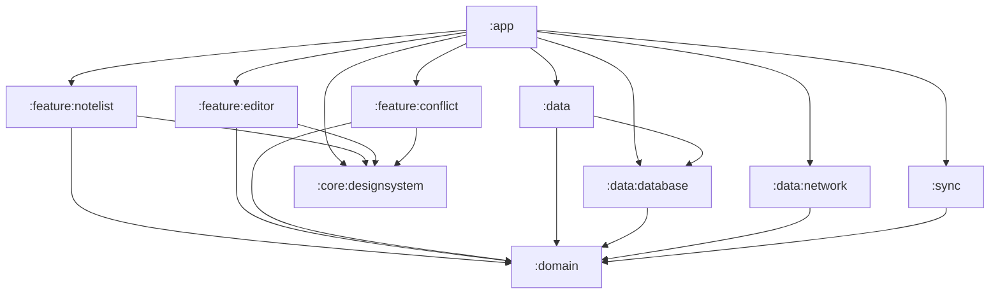
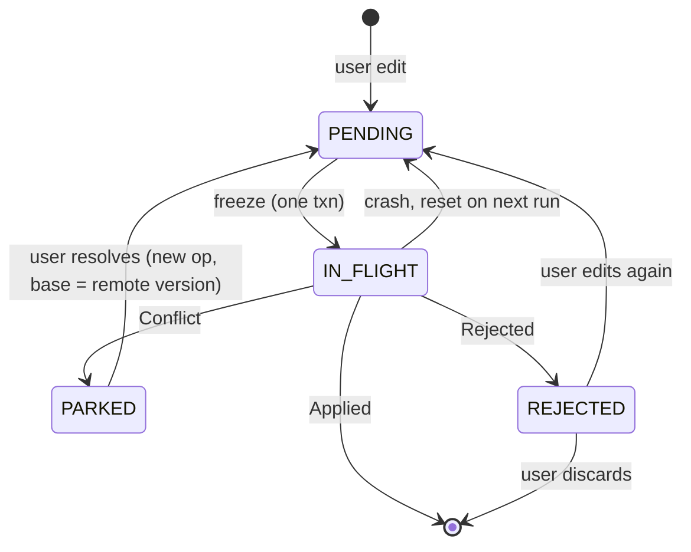

# Offline-First Notes

An Android notes app built around one problem: editing offline on several devices and converging
without losing anyone's work. The sync engine is the product; the UI exists to exercise it.

```bash
./gradlew installDebug
```

Works fully offline the moment it installs. Sync targets a [Mockoon](#running-against-a-mock-server)
mock of the wire contract; no account, no backend to deploy.

## Functional requirements

- Create, edit, search and delete notes with the device offline.
- Every edit is saved locally as it is typed; nothing waits on the network.
- Changes sync to a server in the background and reach the user's other devices.
- Concurrent edits to the same note on two devices are detected and surfaced to the user, who
  picks a side or merges by hand. Nothing is auto-merged.
- A change the server refuses is shown as such, with the reason, and can be edited again or
  discarded.

## Non-functional requirements

| Requirement | What the client guarantees | What it does not |
|---|---|---|
| Durability | A committed edit survives process death. Dismissing the editor mid-write cannot roll back the last keystroke. | A write still in flight at process death. |
| No silent loss | Remote state never overwrites a note that has an unresolved local change — pending, in flight, conflicted or rejected. | Notes with no local change, which a pull is free to update. |
| Idempotent retries | Every operation carries a stable `opId`; a replay is byte-identical to the original. | Server-side dedupe. That is the server's half of the contract. |
| Atomicity | Every multi-table write is one Room transaction. | — |
| Convergence | With eventual connectivity, a conforming server, and conflicts resolved, replicas converge. | Convergence while a conflict is unresolved. |
| Freshness | Sync is *requested* ~30s after the first edit, immediately on editor close or app foreground, and every 6h as a backstop. | Any upper bound on when it runs. WorkManager's delay is the earliest eligible time; Doze and the network constraint push it later. |

## Out of scope

Authentication (a 401 is handled as a terminal outcome, but nothing attaches a credential), rich
text, real-time collaboration and CRDTs, attachments, encryption, sharing between users, push
notifications (FCM), iOS/KMP, and the server itself. Each has a seam where it would attach; see
[design notes](docs/design-notes.md).

## High-level architecture


- **Presentation** — Compose screens and ViewModels. ViewModels call use cases and observe
  `Flow`s from them; they never touch a repository (enforced by a Konsist test).
- **Domain** — a pure Kotlin module: entities, the interfaces the rest of the app implements
  (`NoteRepository`, `NoteSyncOperations`, `SyncTransport`, `SyncTrigger`), use cases, and
  `SyncEngine`. No Android, Room or Retrofit on its classpath.
- **Data** — one repository class behind two interfaces: the UI-facing one and the sync-facing
  one. The sync engine holds only the sync-facing interface, so it cannot write note content.
  Room is the single source of truth; the UI observes it and never the server.
- **Background** — a WorkManager worker runs one sync round: reset stale in-flight ops → freeze
  the outbox → push → apply results → pull delta pages → apply with the skip rule.
- **`:app`** — composition root: Hilt graph, `NavHost`, `Application` with WorkManager config.



## API contract

Two endpoints, specified in [`openapi/offline-notes.yaml`](openapi/offline-notes.yaml).

| Endpoint | Request | Response |
|---|---|---|
| `POST /push` | Array of frozen ops: `opId`, `type` (CREATE/UPDATE/DELETE), `noteId`, `baseVersion`, `title`, `body` | One result per op, in order: `Applied{newVersion}` · `Conflict{base*, remote*}` · `Rejected{code, message}` |
| `GET /pull?since=` | Opaque cursor; omitted for a full snapshot | `{notes[], nextSyncToken, hasMore}` — paged; each note is content or a tombstone |

Rules the schemas can't express:

- **Compare-and-swap.** An op whose `baseVersion` isn't the note's current server version comes
  back as `Conflict`, carrying the remote side (and the base side when history still has it).
- **Per-op independence.** One conflicting or rejected op never fails the batch.
- **Results vs. failures.** `Conflict` and `Rejected` are 200s. 429 and 5xx are retried with the
  same `opId`s. 401 ends the round; there's nothing to retry with. 410 on `/pull` means the cursor
  expired: re-bootstrap.
- **Client-generated `noteId`** — a note has an identity before it has ever synced.

## Data model

Room, schema v2 (`data/database/schemas/`), `BundledSQLiteDriver` for FTS5.

| Table | Purpose | Key columns |
|---|---|---|
| `notes` | Current local state of every note | `id` PK · `title` · `body` · `serverVersion?` · `syncState` (derived) · `isDeleted` |
| `outbox` | Every local change not yet acknowledged by the server | `opId` PK · `noteId` FK · `opType` · `status` · `baseVersion` resolved at freeze · `rejectionCode?`/`rejectionMessage?` |
| `note_conflicts` | The three inputs of a staged conflict | `noteId` PK · `opId` FK (cascade) · `base*` · `remote*` |
| `sync_meta` | The pull cursor | singleton row · `syncToken?` |
| `notes_fts` | FTS5 external-content index over `notes` | maintained by triggers |

Two constraints are schema-level rather than convention:

- **One mutable op per note.** A partial unique index on `outbox(noteId) WHERE status = 'PENDING'`
  means rapid edits coalesce into the same row, while an edit during an in-flight op creates a
  new one. The frozen op is never mutated — that's what makes `opId` an honest idempotency key.
- **Derived `syncState`.** Every transaction that touches `outbox` or `note_conflicts` ends by
  recomputing the note's state from those tables: `CONFLICT` > `REJECTED` > `PENDING` > `SYNCED`.
  The badge can't disagree with the rows it summarises.

## State diagrams

Op lifecycle — the state of one row in `outbox`:



An op row is only ever deleted when its data is on the server or the user explicitly supersedes or
discards it. No TTL, no GC.

## Implementation notes

- **Skip rule.** A pulled change is applied only if the note has no live outbox row. That single
  check is what protects local edits; every serious defect found while building this lived next
  to it, not in the type system.
- **Conflicts are detected on push only.** A pull carries no `baseVersion`, so it can avoid
  creating a conflict but never detect one. Resolution is an ordinary `UPDATE` with a new `opId`
  and `baseVersion = remoteVersion` — there is no `/resolve` endpoint.
- **Rejection is terminal for the op, not the edit.** The row stays, marked `REJECTED` with the
  server's reason, which keeps the skip rule armed. Editing again supersedes it; discarding lets
  the next pull reconcile.
- **Bootstrap is a three-call protocol.** Pages are applied as they arrive; the sweep that deletes
  locally-synced notes the server no longer has runs once, against the union of every page, and
  only then is the cursor advanced. A crash mid-bootstrap leaves extra notes, never missing ones.
- **The last keystroke is `NonCancellable`.** Dismissing the editor cancels `viewModelScope`;
  wrapping the write in `withContext(NonCancellable)` lets the in-flight transaction commit.
- **Sync triggers.** Delay-from-*first*-edit, not debounce-from-last — a debounce never fires
  during continuous typing. Editor close and foreground request an immediate round.

## Alternatives considered

- **Server-side auto-merge (`Merged` result).** Cut: applying merged text into a note the user is
  still typing in either reverts under their cursor or drops the other device's change on the next
  push. Non-overlapping concurrent edits now surface as conflicts instead.
- **Dirty flag instead of an outbox.** Can't say *what* changed, can't survive a partial apply,
  gives no idempotency key. The outbox makes "no pending op" a provable precondition for a pull.
- **Owning a reference server.** An earlier version shipped a Ktor backend. Cut: a client has to
  be correct against the contract it's given, not one it invented. Mockoon plays the contract.
- **Application-scoped write** to protect the last keystroke. Google's documented pattern, and it
  worked; replaced by one `NonCancellable` line because that was the only write that needed it.
- **FCM, KMP/iOS.** Additive later; each would be a weaker claim than an honest single-platform
  client today.

## Running the app

```bash
./gradlew installDebug
```

### Running against a mock server

```bash
npx @mockoon/cli start --data mockoon/offline-notes.json --port 8080
```

The debug build points at `http://10.0.2.2:8080/` (the emulator's alias for the host) via
`BuildConfig.API_BASE_URL` in `data/network/build.gradle.kts`. Each route ships several responses;
enable one at a time in the Mockoon UI to drive a scenario:

- **Conflict** on `POST /push`, then edit a note — the conflict banner appears on the next sync.
- **Rejected** on `POST /push` — the note shows *Not saved* with the reason and a Discard action.
- **Remote change** on `GET /pull`, then foreground the app — a note edited elsewhere arrives.
- **410** on `GET /pull` — the client discards its cursor and re-bootstraps.

Mockoon is stateless, so it drives every client path but cannot show two devices converging.

### Tests and checks

```bash
./gradlew test                       # 92 unit tests, every module
./gradlew lint detektAll             # Android Lint (warnings are errors) + detekt with type resolution
./gradlew connectedDebugAndroidTest  # 5 instrumented tests: FTS5 and the schema migration
```

`SyncEngine` is tested in pure JVM against fake ports; `NoteTransactions` against a real Room
instance under Robolectric. Each named scenario test corresponds to a defect found while building
this — see [design notes](docs/design-notes.md#testing) for the list.

## Tech stack

Kotlin 2.2 · Compose / Material 3 · Room 2.8 · WorkManager · Hilt · Coroutines/Flow ·
Retrofit/OkHttp + kotlinx-serialization · detekt · Konsist · Mockoon.
