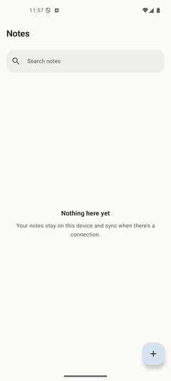
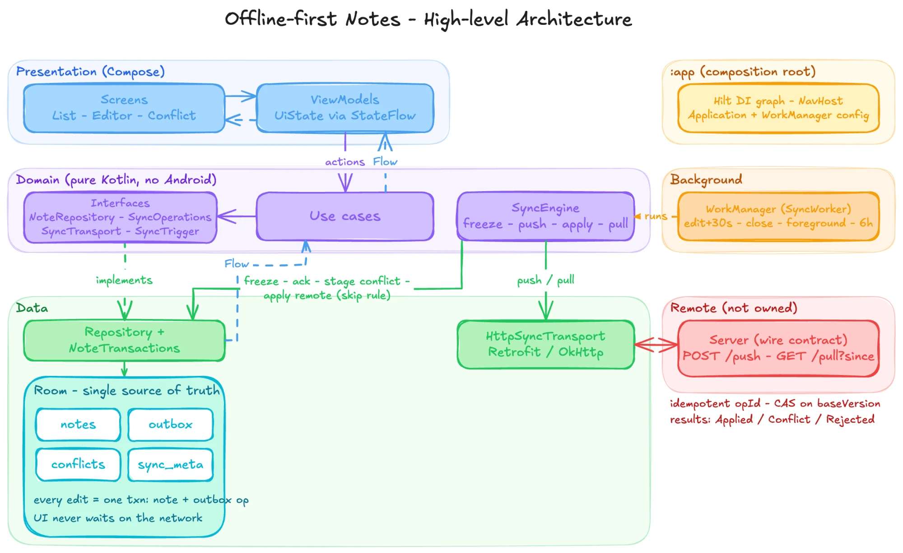
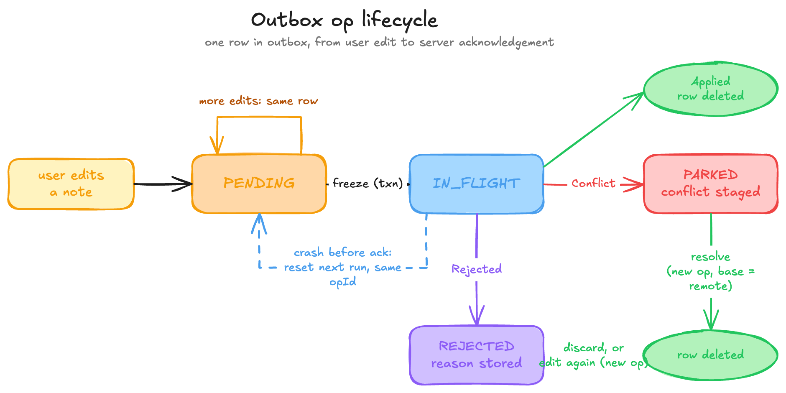
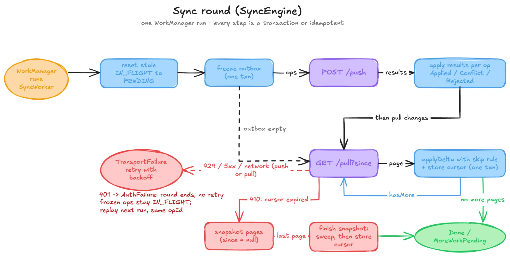

# Offline-First Notes

An Android notes app built around one problem, editing offline on several devices and converging
without losing anyone's work. Most of the code is the sync engine, the UI is there to exercise it.

<table>
  <tr>
    <td align="center"><br><sub>Edit offline, sync later</sub></td>
    <td align="center"><br><sub>Conflict, resolved by the user</sub></td>
    <td align="center"><br><sub>Server rejects a change</sub></td>
    <td align="center"><br><sub>Change arrives from another device</sub></td>
  </tr>
</table>

## Functional requirements

- Create, edit, search and delete notes with the device offline.
- Every edit is saved locally as it is typed. Nothing waits on the network.
- Changes sync to a server in the background and reach the user's other devices.
- Concurrent edits to the same note on two devices are detected and shown to the user, who picks
  a side or merges by hand. Nothing is auto-merged.
- A change the server refuses is shown as such, with the reason. It can be edited again or
  discarded.

## Non-functional requirements

| Requirement | What the client guarantees | What it does not |
|---|---|---|
| Durability | A committed edit survives process death. Dismissing the editor mid-write cannot roll back the last keystroke. | A write still in flight at process death. |
| No silent loss | Remote state never overwrites a note that has an unresolved local change, whether pending, in flight, conflicted or rejected. | Notes with no local change, which a pull is free to update. |
| Idempotent retries | Every operation carries a stable `opId`. A replay is byte-identical to the original. | Server-side dedupe. That is the server's half of the contract. |
| Atomicity | Every multi-table write is one Room transaction. | Nothing. |
| Convergence | With eventual connectivity, a conforming server, and conflicts resolved, replicas converge. | Convergence while a conflict is unresolved. |
| Freshness | Sync is *requested* about 30s after the first edit, immediately on editor close or app foreground, and every 6h as a backstop. | Any upper bound on when it runs. WorkManager's delay is the earliest eligible time, Doze and the network constraint can push it later. |

## Out of scope

Authentication (a 401 is handled as a terminal outcome, but nothing attaches a credential), rich
text, real-time collaboration and CRDTs, attachments, encryption, sharing between users, push
notifications (FCM), iOS/KMP, and the server itself. Each of these has an obvious seam to attach to.

## High-level architecture



- **Presentation.** Compose screens and ViewModels. ViewModels call use cases and observe `Flow`s
  from them. They never touch a repository, a Konsist test enforces that.
- **Domain.** A pure Kotlin module. Entities, the interfaces the rest of the app implements
  (`NoteRepository`, `NoteSyncOperations`, `SyncTransport`, `SyncTrigger`), use cases, and
  `SyncEngine`. No Android, Room or Retrofit on its classpath.
- **Data.** One repository class behind two interfaces, the UI-facing one and the sync-facing one.
  The sync engine only holds the sync-facing interface, so it cannot write note content. Room is
  the single source of truth, the UI observes it and never the server.
- **Background.** A WorkManager worker runs one sync round. Reset stale in-flight ops, freeze the
  outbox, push, apply results, pull delta pages, apply them with the skip rule.
- **`:app`.** The composition root. Hilt graph, `NavHost`, and the `Application` with the
  WorkManager config.

## API contract

Two endpoints, specified in [`openapi/offline-notes.yaml`](openapi/offline-notes.yaml).

| Endpoint | Request | Response |
|---|---|---|
| `POST /push` | Array of frozen ops: `opId`, `type` (CREATE/UPDATE/DELETE), `noteId`, `baseVersion`, `title`, `body` | One result per op, in order: `Applied{newVersion}`, `Conflict{base*, remote*}`, `Rejected{code, message}` |
| `GET /pull?since=` | Opaque cursor, omitted for a full snapshot | `{notes[], nextSyncToken, hasMore}`, paged. Each note is either content or a tombstone |

Rules the schema cannot express.

- **Compare-and-swap.** An op whose `baseVersion` isn't the note's current server version comes
  back as `Conflict`, carrying the remote side, and the base side when history still has it.
- **Per-op independence.** One conflicting or rejected op never fails the batch.
- **Results vs. failures.** `Conflict` and `Rejected` are 200s. 429 and 5xx are retried with the
  same `opId`s. 401 ends the round, there is nothing to retry with. 410 on `/pull` means the cursor
  expired, so the client re-bootstraps.
- **Client-generated `noteId`.** A note has an id before it has ever synced.

## Data model

Room, schema v1 (`data/database/schemas/`), `BundledSQLiteDriver` for FTS5.

| Table | Holds |
|---|---|
| `notes` | The current local state of every note |
| `outbox` | Every local change the server has not yet acknowledged |
| `note_conflicts` | The three inputs of a staged conflict: base, local, remote |
| `sync_meta` | The pull cursor (one row) |
| `notes_fts` | FTS5 index over `notes`, kept in sync by triggers |

```text
notes           id PK, title, body, serverVersion?, syncState, isDeleted, createdAt, lastUpdated
outbox          opId PK, noteId -> notes, opType, title?, body?, status, createdAt,
                attemptCount, rejectionCode?, rejectionMessage?
note_conflicts  noteId PK, opId -> outbox (cascade), baseVersion?, baseTitle?, baseBody?,
                remoteVersion, remoteTitle, remoteBody, detectedAt
sync_meta       id = 0, syncToken?
```

`?` marks a nullable column. `syncState` is derived (see below). `baseVersion` is not stored on the
op, it is read from `notes.serverVersion` at freeze time.

Two constraints live in the schema rather than in convention.

- **One mutable op per note.** A `BEFORE INSERT` trigger on `outbox` rejects a second `PENDING`
  row for the same note. Rapid edits coalesce into one row, an edit during an in-flight op creates
  a new one. The frozen op is never mutated, so `opId` works as an idempotency key. It is a trigger
  rather than a partial unique index because Room can't model partial indices, and a unique index
  would also reject the crash-recovery case where a replayed op and a newer edit are both
  `PENDING`. A round freezes only the oldest op per note, so the replay is acknowledged first and
  the newer edit ships with the right `baseVersion`.
- **Derived `syncState`.** Every transaction that touches `outbox` or `note_conflicts` ends by
  recomputing the note's state from those tables, `CONFLICT` > `REJECTED` > `PENDING` > `SYNCED`.
  So the badge in the list is always computed from the same rows it summarises.

## State diagrams

**Outbox op lifecycle.** The state of one row in `outbox`, from a user edit to the server's
acknowledgement. A row is never mutated after freeze. Resolving a conflict or editing again
creates a new row with a new `opId`, in the same transaction that deletes the old one.



**Sync round.** What one WorkManager run does. Every step is either a transaction or idempotent,
so a crash at any point is recovered by the next run.



## Implementation notes

- **Skip rule.** A pulled change is applied only if the note has no live outbox row. That one
  check is what protects local edits. Most of the defects found while building this were next to
  it.
- **Conflicts are detected on push only.** A pull carries no `baseVersion`, so it can avoid
  creating a conflict but never detect one. Resolution is an ordinary `UPDATE` with a new `opId`
  and `baseVersion = remoteVersion`, so there is no `/resolve` endpoint.
- **Rejection.** The op ends, the edit stays. The row is kept and marked `REJECTED` with the
  server's reason, which keeps the skip rule armed. Editing again supersedes it, discarding lets
  the next pull reconcile.
- **Bootstrap is a three-call protocol.** Pages are applied as they arrive. The sweep that deletes
  locally-synced notes the server no longer has runs once, against the union of every page, and
  only then is the cursor advanced. So a crash mid-bootstrap can leave extra notes but not missing
  ones.
- **The last keystroke is `NonCancellable`.** Dismissing the editor cancels `viewModelScope`, so
  the write is wrapped in `withContext(NonCancellable)` and the in-flight transaction commits.
- **Sync triggers.** The delay counts from the first edit rather than the last, a debounce never
  fires during continuous typing. Closing the editor or foregrounding the app requests an
  immediate round.

## Alternatives considered

- **Server-side auto-merge (`Merged` result).** Cut because applying merged text into a note the
  user is still typing in either reverts under their cursor or drops the other device's change on
  the next push. So non-overlapping concurrent edits surface as conflicts instead.
- **Dirty flag instead of an outbox.** A flag can't say *what* changed and gives no idempotency
  key, so a partial apply can't be recovered either. The outbox makes "no pending op" a provable
  precondition for a pull.
- **Owning a reference server.** An earlier version shipped a Ktor backend. Cut, I wanted the
  client tested against a contract it doesn't control. Mockoon plays that contract.
- **Application-scoped write** to protect the last keystroke. Google's documented pattern, and it
  worked. Replaced by one `NonCancellable` line, since that was the only write that needed it.
- **FCM, KMP/iOS.** Both can be added later without touching the sync engine.

## Running the app

```bash
./gradlew installDebug
```

It works offline from the first launch and needs nothing else installed. With no server reachable,
edits stay `PENDING` and the worker retries with backoff. To see sync, point it at the Mockoon mock
of the wire contract below.

### Running against a mock server

```bash
npx @mockoon/cli start --data mockoon/offline-notes.json --port 8080
```

The debug build points at `http://10.0.2.2:8080/` (the emulator's alias for the host) via
`BuildConfig.API_BASE_URL` in `data/network/build.gradle.kts`. Each route ships several responses,
enable one at a time in the Mockoon UI to drive a scenario.

- **Conflict** on `POST /push`, then edit a note you created. The conflict banner appears on the next sync. Resolving is accepted, a rule matches the resolution's `baseVersion`.
- **Rejected** on `POST /push`. The note shows *Not saved* with the reason and a Discard action.
- **Remote change** on `GET /pull`, then foreground the app. A note edited elsewhere arrives.
- **410** on `GET /pull`. The client discards its cursor and re-bootstraps.

Mockoon is stateless, so it drives every client path but cannot show two devices converging.

### Tests and checks

```bash
./gradlew test                       # 100 unit tests, every module
./gradlew lint detektAll             # Android Lint (warnings are errors) + detekt with type resolution
./gradlew connectedDebugAndroidTest  # 4 instrumented tests: FTS5 search
```

`SyncEngine` is tested on the JVM against fake ports, `NoteTransactions` against a real Room
instance under Robolectric. Most of the named scenario tests came from a defect found while
building this, so the test names in `NoteTransactionsTest` and the two `SyncEngineTest`s double
as the defect list.

## Tech stack

Kotlin 2.2 · Compose / Material 3 · Room 2.8 · WorkManager · Hilt · Coroutines/Flow ·
Retrofit/OkHttp + kotlinx-serialization · detekt · Konsist · Mockoon.

## License

[MIT](LICENSE).
