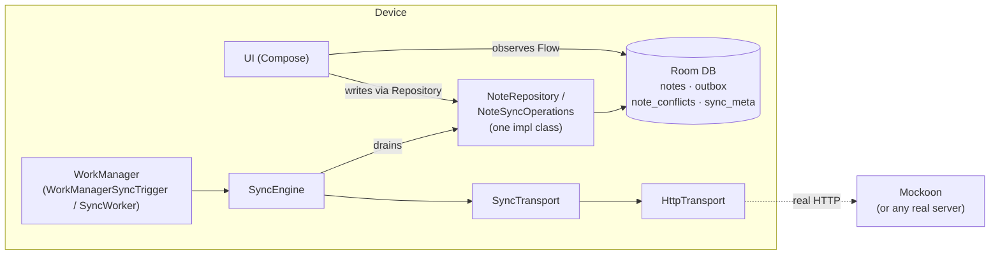
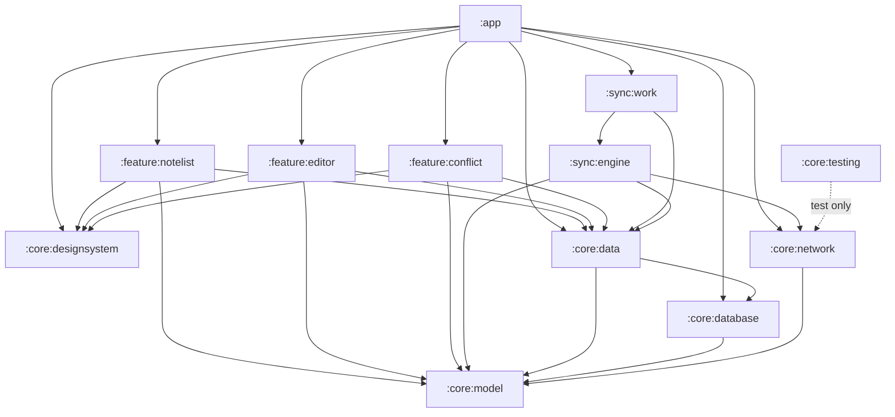
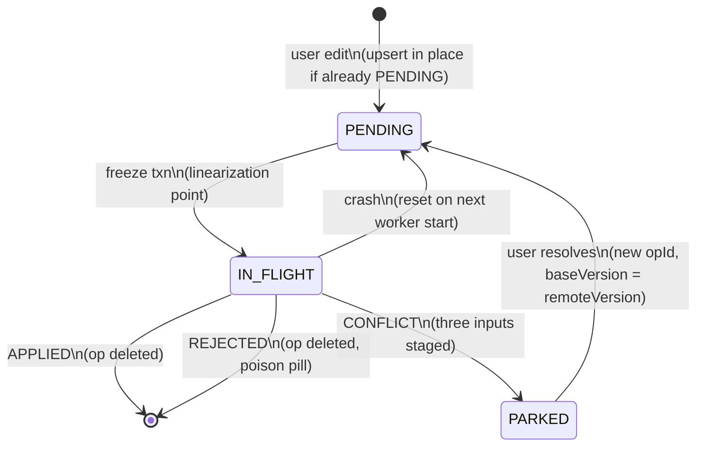
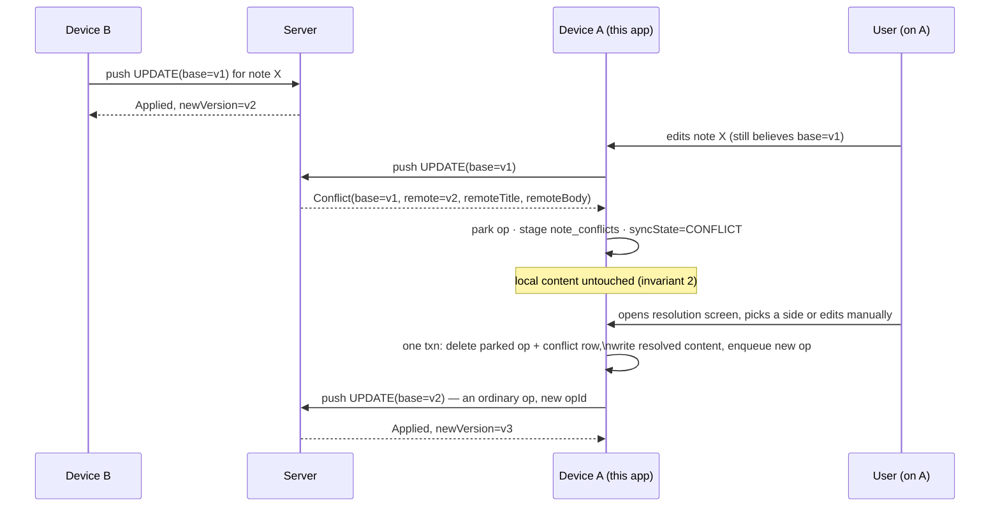

# Offline-First Notes

A showcase Android app implementing an offline-first note-taking feature with multi-device sync.
The sync engine is the product; the UI exists to exercise it. This README carries the invariants
and the failure model — the reasoning behind the design, not just the design.

```bash
./gradlew installDebug
```

No credentials, no account registration, no backend to deploy. This repo doesn't own backend
semantics — the app is a client against a wire contract, full stop — so the default build runs
against a scriptable in-process stub, and it's fully functional offline the moment it installs.

## Invariants

Every design decision in this repo traces back to one of these five. They are not aspirational —
they're enforced by the schema, the transaction boundaries, and the tests in §Testing below.

1. **Zero data loss.** No user edit is ever silently discarded. Every local mutation is durable
   before it is acknowledged to the user.
2. **Content-write rule.** Note content (`title`, `body`) is written by exactly two things: the
   user's own edits, and remote state the user has no pending local edits against. Nothing else
   may ever write content — in particular, push responses never write content.
3. **Local writes never wait on the network.** Room is the single source of truth; the UI
   observes Room via `Flow`. Sync is entirely off the interactive path.
4. **Atomicity.** Every multi-table mutation is a single Room transaction. A crash between two
   related writes must be impossible.
5. **Idempotent retries.** Any request may be sent more than once. Re-sending must never
   duplicate an effect.

## Architecture



### Module graph



Each arrow is `implementation`, not `api` — a module sees only what it directly declares, not
what its dependencies depend on. `:core:model` is the only module every other module can see; it's
a plain Kotlin/JVM module with no Android dependency, so it can't smuggle one in by accident.

**No `:core:domain` module, on purpose.** The domain layer didn't disappear — it's `:core:model`
(the plain-Kotlin domain types: `Note`, `NoteConflict`, `SyncModels`) plus `NoteRepository` /
`NoteSyncOperations` / `SyncTrigger`, which live directly in `:core:data`, next to the one class
that implements all three. An earlier version of this graph put those interfaces in a standalone
`:core:domain` module instead, separate from `:core:data`'s implementation of them. That split
existed for exactly one reason: the sync engine needed to see `NoteSyncOperations` without
depending on `:core:data`, because `:core:data` depended on the engine right back (for the
WorkManager scheduler) — an actual cycle if interface and impl lived together. Once the WorkManager
trigger moved out into its own module (`:sync:work`, below), that reverse edge disappeared, and
with it the only reason `:core:domain` existed. This app has no use cases, no logic that composes
multiple repositories — just one repository behind two interfaces plus a trigger — so a "domain
layer" module was never earning its name.

**`:sync:engine` and `:sync:work` are two modules, both under `:sync:`, for one reason: WorkManager.**
`:sync:engine` (`SyncEngine`, the freeze→push→apply→pull orchestration) depends only on
`:core:data` and `:core:network` — no Android framework dependency beyond what those already
carry. `:sync:work` is the only module that knows WorkManager exists: it holds `SyncWorker`
(the `CoroutineWorker`) and `WorkManagerSyncTrigger`, the sole implementation of `:core:data`'s
`SyncTrigger` interface (`requestSync()` / `requestImmediateSync()`) that `NoteRepositoryImpl` and
`NoteEditorViewModel` call after a write. Neither of those two ever depends on `:sync:work`, or
even knows WorkManager is the mechanism behind `SyncTrigger` — Hilt resolves the binding at
`:app`, where both `:core:data` and `:sync:work` are on the classpath together. Swapping the
trigger mechanism (a different scheduler, a test double) means writing a new `SyncTrigger` and
touching `:app`'s dependency list — nothing else. Both modules sit under `:sync:`, not `:core:`,
because sync is a vertical subsystem with its own two-part shape (portable engine, platform
trigger) — `:core:` is reserved for foundational pieces (model, database, network, data,
designsystem, testing) that any feature might depend on directly, not for a subsystem that
happens to have a small piece.

**`:core:testing`** holds `FakeTransport`, a `SyncTransport` test double currently used only by
`SyncEngineTest`. It's a separate module rather than living inside `:sync:engine`'s own test
sources so the next module that needs a scriptable `SyncTransport` for its own tests has somewhere
to `testImplementation` it from, rather than depending on another module's test sources (which
Gradle doesn't expose) or copy-pasting the fake.

**This repo owns the client only.** There's no owned reference server implementation: the app is
a correct client of a wire contract — specified in [`openapi/offline-notes.yaml`](openapi/offline-notes.yaml)
and typed in [`RemoteDtos.kt`](core/network/src/main/kotlin/com/savvasg/offlinenotes/core/network/dto/RemoteDtos.kt) —
and whatever answers on the other end of `HttpTransport` — a real backend, or the
[Mockoon environment](mockoon/) checked in here — is out of scope for what this repo
demonstrates. The app ships exactly one transport, `HttpTransport`; the base URL comes from a
per-build-type `BuildConfig.API_BASE_URL`, so there is nothing to switch at runtime.

**One repository implementation behind two interfaces.** `NoteRepository` is UI-facing
(`observeNotes`, `saveNote`, `resolveConflict`, ...); `NoteSyncOperations` is sync-facing
(`freezeAndDrain`, `applyResult`, `stageConflict`, `applyDelta`, `resetStaleInFlight`). The sync
engine only ever sees `NoteSyncOperations` — it is *structurally incapable* of calling
`saveNote()`, because that method isn't on the interface it holds a reference to. This is what
makes invariant 2 a compile-time guarantee rather than a code-review discipline: if the sync
engine generated an outbox op from pulled data, it would echo the server's own changes back at
it.

## The op lifecycle



An op row is deleted only when its data is on the server, or the user has explicitly superseded
it. No TTL, no GC — expiry would be silent data loss. Edits arriving while an op is `IN_FLIGHT` or
`PARKED` create a **new** row rather than mutating the in-flight one; the partial unique index
`idx_outbox_one_pending` (WHERE `status = 'PENDING'`) is what makes "at most one *mutable* op per
note" a schema-level fact, not a convention.

## Conflict sequence



Detection happens **only on push** — a pull carries no `baseVersion`, so it can only avoid
creating conflicts (the skip rule), never detect one. There is no `/resolve` endpoint: resolution
is an ordinary `UPDATE` op with the same idempotency and CAS as any other write.

## Sync triggers

| Trigger | Behaviour |
|---|---|
| First edit | Enqueue unique work (`KEEP`) with initial delay **W ≈ 30s**. Subsequent edits no-op. |
| Connectivity regained | Free — the queued work's network constraint fires. |
| Editor close / app background | Expedited, no delay. Flushes the session tail. |
| App foreground | Delta pull. Primary freshness mechanism. |
| Periodic | Long-interval backstop only (≥ 6h). |

**W is the bounded data-loss window** — the maximum span of typing that exists on one device
only — named as such in [`WorkManagerSyncTrigger`](sync/work/src/main/kotlin/com/savvasg/offlinenotes/sync/work/WorkManagerSyncTrigger.kt).
It's delay-*from-first-edit*, not debounce-from-last: a debounce never fires during continuous
typing, so staleness would grow unbounded exactly when the user is producing the most unsynced
work.

No FCM: pull-on-foreground meets the freshness bar for a feature-tier product, at the cost of a
wider multi-device concurrency window — absorbed by the conflict machinery above, not by
correctness.

## Run the hard cases yourself

The failure paths are driven from the server side, by whatever `HttpTransport` is pointed at.
[`mockoon/offline-notes.json`](mockoon/) is a starter environment implementing the wire contract:

```bash
npx @mockoon/cli start --data mockoon/offline-notes.json --port 8080
```

The debug build points at `http://10.0.2.2:8080/` (the emulator's alias for the host) via
`BuildConfig.API_BASE_URL`; change that value in `app/build.gradle.kts` to target a physical
device at the host's LAN IP, or a real backend.

Enable Mockoon's Conflict response for `POST /push` (or add a rule keyed on `noteId`), edit that
note locally, and the conflict banner appears on the next sync. Run two app instances against the
same Mockoon instance to watch two devices converge on shared state.

**Scenario tests** (see below) exercise every one of these paths without a UI at all.

## Testing

```bash
./gradlew testDebugUnitTest         # 48 tests, across every module that has any
./gradlew connectedDebugAndroidTest # 4 tests (:core:database), needs a device/emulator
```

Unqualified: unit tests live wherever the thing they test lives (`:core:database`,
`:core:network`, `:sync:engine`, `:sync:work`, `:core:data`, `:feature:editor`), not all in
`:app`, and an unqualified Gradle task name runs in every module that declares it.

CI (`.github/workflows/ci.yml`) runs both on every push: a plain JVM job for the unit tests, and a
`reactivecircus/android-emulator-runner` job for the instrumented ones.

Named scenario tests, each corresponding to a real defect found while designing this system:

| Test | Where | Asserts |
|---|---|---|
| `only_one_pending_op_per_note` | `NoteTransactionsTest` | Rapid edits coalesce in place; the unique index holds. |
| `base_version_resolved_at_drain_not_creation` | `NoteTransactionsTest` | An op created before a prior ack ships the *post-ack* version. |
| `apply_result_never_overwrites_content` | `NoteTransactionsTest` | After `APPLIED`, `body` still holds edits made after the freeze. |
| `conflict_parks_op_and_stages_all_three_inputs` | `NoteTransactionsTest` | Local in `notes`, base+remote in `note_conflicts`, op `PARKED`. |
| `resolution_supersedes_parked_op` | `NoteTransactionsTest`, `SyncEngineTest` | One transaction; new op with `baseVersion = remoteVersion`. |
| `delete_edit_race_resurrects` | `NoteTransactionsTest` | Remote tombstone vs. local pending edit → note survives. |
| `expired_token_triggers_rebootstrap` | `NoteTransactionsTest` | Local-only notes survive; previously-synced-and-now-absent notes are purged. |
| `pull_skips_notes_with_pending_ops` | `NoteTransactionsTest`, `SyncEngineTest` | A remote change never clobbers a note being edited locally. |
| `edit_during_in_flight_creates_second_op_and_loses_nothing` | `NoteTransactionsTest`, `SyncEngineTest` | A mid-flight edit lands in a new op; the ack deletes only the frozen one. |
| `crash_between_send_and_ack_replays_safely` | `SyncEngineTest` | Stale `IN_FLIGHT` resets to `PENDING` and replays with the *same* `opId` — never a fabricated new one. |
| `long_editing_session_produces_one_request_per_window` | `WorkManagerSyncTriggerTest` | 20 debounced schedule calls collapse to one `ENQUEUED` work item. |
| FTS DAO tests | `NoteDaoFtsTest` (instrumented) | Search matches title/body, excludes deleted notes, reflects updates. |

Plus `HttpTransportTest` (7 tests, MockWebServer: serialization, status-code → exception mapping)
and `BuildFtsMatchQueryTest` (6 tests: the FTS5 query-injection-safe prefix-match builder).

Since this repo doesn't own backend semantics, `crash_between_send_and_ack_replays_safely` and
`resolution_supersedes_parked_op` assert what's actually the *client's* responsibility — sending
the identical `opId`/op on retry — rather than a specific server-side dedupe outcome, which would
require the test double to fake real backend state.

## Rejected alternatives

**`MERGED` push result.** An earlier version had the server auto-merge non-overlapping edits and
return merged content directly. Cut because it violates invariant 2: applying merged content into
a note the user is still editing either reverts text under their cursor, or — if you skip the
write — silently loses the other device's contribution when the next local op ships. The only
paths third-party content can enter the client are now the pull (guarded by the skip rule) and
the conflict payload (parked, user-mediated, never auto-applied). Cost: concurrent
non-overlapping edits that *could* have merged now surface as conflicts — the right trade for a
notes feature.

**FCM push.** For a feature-tier product the push taxonomy is cross-team cost; pull-on-foreground
meets the freshness bar. The consequence — a wider concurrency window, more conflicts — is
absorbed by the conflict machinery, not by correctness. Adding a push trigger later is additive
(it's just another caller of `SyncTrigger.requestImmediateSync()`).

**Owning a reference backend (`server-core` + a Ktor `:server` module).** An earlier version of
this repo did exactly that — a plain-Kotlin state machine (CAS, opId dedupe, a change log) shared
in-process by the fake transport and wrapped in Ktor routes for a real-HTTP demo. Cut because it's
scope creep for what this repo is actually meant to demonstrate: an offline-first *client*. Real
products don't get to invent their own backend semantics to match their client's convenience —
the client has to be correct against whatever contract the backend team actually ships, which is
exactly what `HttpTransport` + a Mockoon-mocked (or genuinely real) server represents. The cost:
the test double can no longer fake real CAS/conflict detection on its own, so scenario tests now
script the exact response each case needs (`forceConflictOnNextPush`, `queueNextPullPage`)
instead of driving real server-side state — arguably a clearer signal of what's actually being
tested, since the assertion is about the client's reaction, not about a fake server's fidelity.

**KMP / iOS.** The sync engine would port cleanly, but the trigger layer (WorkManager) has no
iOS equivalent, and a `shared` module with no real iOS consumer is a weaker claim than an honest
single-platform project.

**Dirty-flag vs. outbox.** A boolean "this note is dirty" flag can't express *what* changed, only
*that* something did — it can't survive a partial apply (which field synced?), can't coalesce
predictably, and gives you no idempotency key for retry. The outbox is what makes "the note has
no PENDING/IN_FLIGHT op" a *provable* precondition for blindly applying a pull, rather than a
hope.

## Explicitly out of scope

Rich text (a structured format would force the merge layer to be re-litigated — a separate
project), real-time collaboration and CRDTs, attachments, end-to-end encryption, sharing between
users, FCM push, KMP/iOS, and — deliberately — backend implementation of any kind. Each has a seam
in the design above where it would attach.

## Tech stack

**App:** Kotlin 2.2, Compose, Material 3, Room 2.8 (BundledSQLiteDriver — see below), WorkManager,
Hilt, Coroutines/Flow, Retrofit/OkHttp + kotlinx-serialization.
**Mock backend:** [Mockoon](mockoon/) (static/rule-based HTTP mocks). The contract it answers to
is specified in [`openapi/offline-notes.yaml`](openapi/offline-notes.yaml).
**Test:** JUnit, Robolectric, AndroidX Test, Turbine-compatible coroutines-test, MockWebServer,
`WorkManagerTestInitHelper`, MockK, Truth.

### A note on FTS5

The app builds Room against `androidx.sqlite`'s `BundledSQLiteDriver` rather than the platform's
own SQLite. This isn't a style choice — the OS-provided SQLite is **not** guaranteed to include
the FTS5 extension search depends on; this was confirmed by an actual crash on an API 36 emulator
image during development. The bundled driver ships its own SQLite with FTS5 compiled in, so
behavior is identical on every device. The one place this doesn't reach is Robolectric's own
bundled SQLite (a separate native binary, JVM-only) — unit tests build the database schema-only
and FTS5 gets its coverage from the instrumented `NoteDaoFtsTest` instead.
