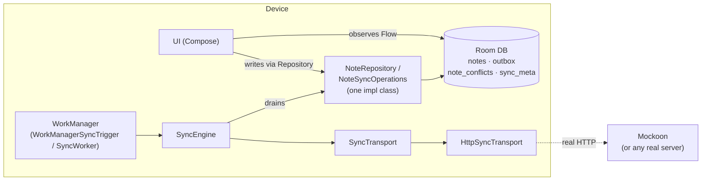
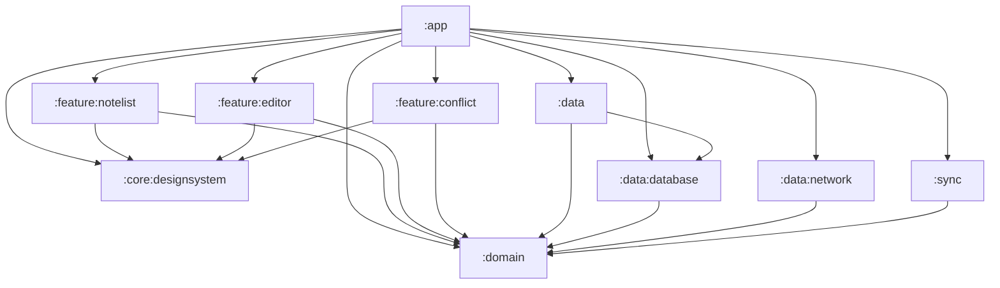
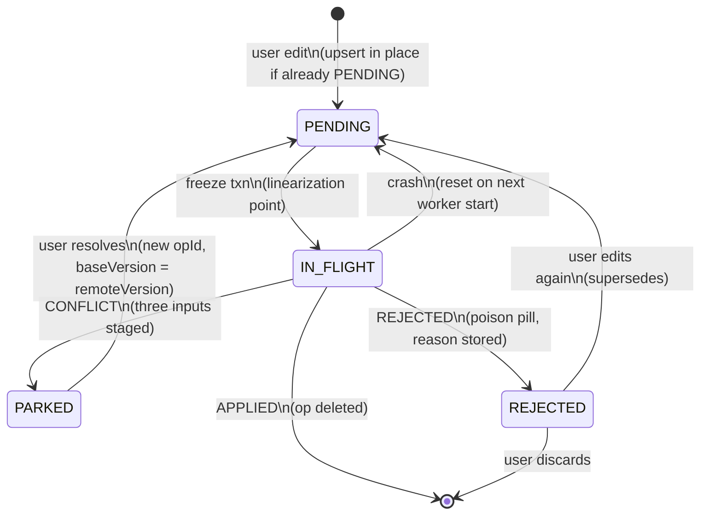
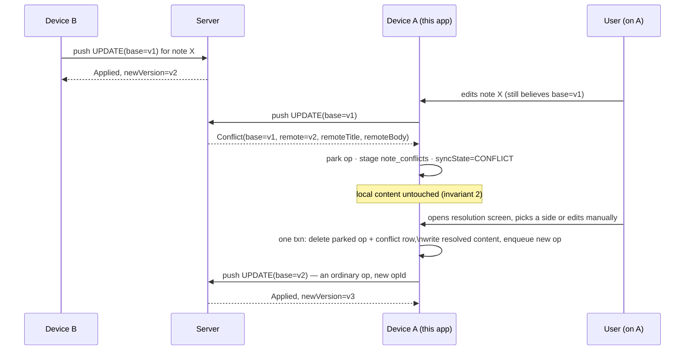

# Offline-First Notes

A showcase Android app implementing an offline-first note-taking feature with multi-device sync.
The sync engine is the product; the UI exists to exercise it. This README carries the invariants
and the failure model — the reasoning behind the design, not just the design.

```bash
./gradlew installDebug
```

No credentials, no account registration, no backend to deploy. This repo doesn't own backend
semantics — the app is a client against a wire contract, full stop — so the default build runs
against a scriptable in-process stub, and it's fully functional offline the moment it installs.

## Invariants

Every design decision in this repo traces back to one of these five. They are not aspirational —
they're enforced by the schema, the transaction boundaries, and the tests in §Testing below.
Each is stated narrowly on purpose; §Guarantees below says exactly how far each one reaches.

1. **Zero data loss.** No user edit is ever silently discarded. Every local mutation is durable
   before it is acknowledged to the user.
2. **Content-write rule.** Note content (`title`, `body`) is written by exactly two things: the
   user's own edits, and remote state the user has no pending local edits against. Nothing else
   may ever write content — in particular, push responses never write content.
3. **Local writes never wait on the network.** Room is the single source of truth; the UI
   observes Room via `Flow`. Sync is entirely off the interactive path.
4. **Atomicity.** Every multi-table mutation is a single Room transaction. A crash between two
   related writes must be impossible.
5. **Idempotent retries.** Any request may be sent more than once. Re-sending must never
   duplicate an effect.

## Guarantees

An invariant is only worth as much as its scope. These are the precise claims — what the client
actually guarantees, and where each one stops.

| Concern | What is guaranteed | What is **not** |
|---|---|---|
| Local durability | A committed edit survives process death. The editor's writes run under `NonCancellable`, so dismissing the screen mid-write cannot roll back the last keystroke. | Nothing about the server having seen it. Process death mid-write still costs that write. |
| Retry safety | A given `opId` always names the byte-identical operation. A frozen op is immutable; later edits go to a new row. | Server-side dedupe. The client sends a stable idempotency key; honouring it is the server's half of the contract. |
| Local-edit protection | Remote state never overwrites a note with an unresolved local op — pending, in-flight, parked on a conflict, or rejected. | Notes with no live op, which a pull is free to update. |
| Convergence | Given eventual connectivity, a conforming server, and conflicts the user has resolved, replicas converge. | Convergence while a conflict sits unresolved, or against a server that ignores `baseVersion`. |
| Background scheduling | A sync is *requested* after a target delay. | Any upper bound on when it runs. WorkManager's initial delay is the earliest eligible time; Doze, standby buckets and the network constraint all push it later. |

The last row is the one most worth stating plainly: there is no bounded staleness window on
Android, and any design claiming one is describing the happy path.

## Architecture



### Module graph



Every arrow points at `:domain`, and `:domain` points at nothing. It is a plain
`kotlin("jvm")` module whose only external imports, across the whole module, are
`javax.inject.Inject` and `kotlinx.coroutines.flow.Flow` — no Android, no Room, no Retrofit, no
serialization. That isn't a convention anyone has to remember: those frameworks are not on its
compile classpath, so reaching for one is a compile error rather than a review comment.

**`:domain` holds the entities, the ports, and the business logic.** `Note`, `NoteConflict` and
the sync transfer objects in `domain.model`; `NoteRepository` and `NoteSyncOperations` in
`domain.repository`; `SyncTrigger`, `SyncTransport` and `SyncEngine` in `domain.sync`; and the eight
use cases in `domain.usecase`. The ports are declared here and implemented outward — `:data`
implements the repositories, `:data:network` implements `SyncTransport`, `:sync` implements
`SyncTrigger` — which is why the dependency arrows run inward rather than out.

`SyncTransport` is stated in the app's own vocabulary (`FrozenOutboxOp`, `OpOutcome`,
`RemoteChangePage`), not in wire types. `:data:network` owns the JSON shapes, its own
`WireOpType`, and `Mappers.kt`, which is the single place the two vocabularies meet. A server-side
rename lands in one file and cannot reach the domain at all.

**`:core:` is only for things that are genuinely reusable and carry no business meaning** —
which currently means `:core:designsystem` alone (theme, tokens, components). The layers are
named as layers, because that is what they are; an earlier version of this graph put `data`,
`domain`, `database` and `network` under `:core:` following Google's *Now in Android* sample, but
NiA shares those across six features and this app has one, so the prefix conveyed nothing.

**Business logic that does *not* live in `:domain`, on purpose.** `NoteTransactions`
(`:data:database`) holds the pull skip rule, conflict refresh for parked ops, tombstone-vs-local-edit
resolution, and bootstrap purging. Strict Clean Architecture would place those in the domain layer.
They stay here because every one of them has to execute inside a single Room transaction to satisfy
invariant 4, and hoisting them would mean either exposing a transaction scope through the
repository port — leaking persistence into the domain far more damagingly — or giving up atomicity.
This is the one place the layering yields to a real constraint, and the cost is honest: that file
is the least portable code in the repo and is reachable only through Robolectric and a real Room
instance.

**`:sync` is a WorkManager adapter, not a data source** — `SyncWorker` and
`WorkManagerSyncTrigger`, the only implementation of `SyncTrigger`. It sits beside `:data` rather
than inside it because nesting it under `:data` implied it was one.

`FakeTransport`, the scriptable `SyncTransport` used by `SyncEngineTest`, lives in `:data`'s own
test source set. It is scaffolding for one module's tests, not a shared module: the HTTP-level
scenarios (Applied, Conflict, Rejected, 401, 429, 410) are covered by the
[Mockoon environment](mockoon/) instead.

**This repo owns the client only.** There's no owned reference server implementation: the app is
a correct client of a wire contract — specified in [`openapi/offline-notes.yaml`](openapi/offline-notes.yaml)
and typed in [`RemoteDtos.kt`](data/network/src/main/kotlin/com/savvasg/offlinenotes/data/network/dto/RemoteDtos.kt) —
and whatever answers on the other end of `HttpSyncTransport` — a real backend, or the
[Mockoon environment](mockoon/) checked in here — is out of scope for what this repo
demonstrates. The app ships exactly one transport, `HttpSyncTransport`; the base URL comes from a
per-build-type `BuildConfig.API_BASE_URL`, so there is nothing to switch at runtime.

**One repository implementation behind two interfaces.** `NoteRepository` is UI-facing
(`observeNotes`, `saveNote`, `resolveConflict`, ...); `NoteSyncOperations` is sync-facing
(`freezeAndDrain`, `applyResult`, `stageConflict`, `applyDelta`, `resetStaleInFlight`). The sync
engine only ever sees `NoteSyncOperations` — it is *structurally incapable* of calling
`saveNote()`, because that method isn't on the interface it holds a reference to. If the sync
engine generated an outbox op from pulled data, it would echo the server's own changes back at it;
the split makes that particular mistake unwriteable.

The two interfaces also differ in what cancellation means. Sync writes are resumable through the
outbox, so a stopped worker *should* stop mid-round and `resetStaleInFlight` picks up the pieces.
The editor's writes are not resumable — the keystroke is gone if the transaction rolls back — so
`NoteEditorViewModel` wraps each one in `withContext(NonCancellable)`. Dismissing the editor cancels
`viewModelScope`, but the write already in flight commits. An earlier version reached for an
application-scoped `CoroutineScope` injected into the repository; that is the pattern Google
documents for this case, and it was removed because one line in the ViewModel buys the same
guarantee for the only write that needs it.

That is the whole of what the type system buys, and it is worth being exact about it. Invariant 2
has two halves: *push responses never write content* is structural and holds at compile time; *remote
state only lands on notes with no live local op* is a runtime rule, enforced by the skip check in
`applyRemoteNote` and covered by tests, not by types. Every defect this design has actually
produced lived in the second half.

## The op lifecycle



An op row is deleted only when its data is on the server, or the user has explicitly superseded or
discarded it. No TTL, no GC — expiry would be silent data loss. Edits arriving while an op is
`IN_FLIGHT` or `PARKED` create a **new** row rather than mutating the in-flight one; the partial
unique index `idx_outbox_one_pending` (WHERE `status = 'PENDING'`) is what makes "at most one
*mutable* op per note" a schema-level fact, not a convention.

**A rejection is terminal for the op, never for the edit.** The server refusing an op means
re-sending it is pointless, so it is never retried — but the row stays, in `REJECTED`, carrying the
server's `code` and `message`. That matters for more than the badge: the skip rule keys off a note
having *any* live op, so keeping the row is what stops the next pull from quietly overwriting the
text the server just refused. The user's escape hatches are editing again (which supersedes the
rejected op) or discarding it (which drops the row and lets the next pull reconcile the note). A
rejected `DELETE` also clears the local tombstone — the server says the note still exists, so
hiding it locally would strand it.

**Note `syncState` is derived, never assigned ad hoc.** Every transaction that touches the outbox
or the conflict table ends by recomputing it from those tables, with a fixed precedence:
`CONFLICT` > `REJECTED` > `PENDING` > `SYNCED`. This is why typing during a staged conflict no
longer drops the note out of `CONFLICT` and strands the resolution screen — the state can't
disagree with the rows it's supposed to summarise.

## Conflict sequence



Detection happens **only on push** — a pull carries no `baseVersion`, so it can only avoid
creating conflicts (the skip rule), never detect one. There is no `/resolve` endpoint: resolution
is an ordinary `UPDATE` op with the same idempotency and CAS as any other write.

## Bootstrap after an expired token

When the server rejects a sync token, the client falls back to a full snapshot: it pages through
everything the server has, then deletes any locally-synced note the snapshot didn't mention. That
sweep is the dangerous part, and it is why the snapshot is a three-call protocol rather than one
call per page:

```
applySnapshotPage(page)      # per page — applies rows, touches nothing else
applySnapshotPage(page)
completeSnapshot(ids, token) # once — sweeps, then advances the token
```

Sweeping per page would delete every note that happens to live on a later page, then delete the
earlier pages' notes when the later ones arrive; a two-page bootstrap would leave you holding only
the last page. The sweep therefore runs once, against the union of note ids seen across every
page, and the sync token is written only at completion — an interrupted bootstrap must not leave
the token pointing at a pagination cursor, or the next delta pull would resume from the middle of
a snapshot and silently skip the remainder.

The failure direction is deliberate: a crash mid-bootstrap leaves extra local notes, which the
next snapshot sweeps. It never deletes notes it shouldn't.

## Sync triggers

| Trigger | Behaviour |
|---|---|
| First edit | Enqueue unique work (`KEEP`) with a target delay **W ≈ 30s**. Subsequent edits no-op. |
| Connectivity regained | Free — the queued work's network constraint fires. |
| Editor close / app background | Expedited, no delay. Flushes the session tail. |
| App foreground | Delta pull. Primary freshness mechanism. |
| Periodic | Long-interval backstop only (≥ 6h) — `ensurePeriodicSync()`. |

**W is a target, not a bound.** It is delay-*from-first-edit*, not debounce-from-last: a debounce
never fires during continuous typing, so staleness would grow without limit exactly when the user
is producing the most unsynced work. Anchoring to the first edit caps how long a *typing session*
goes unsynced under good conditions — see
[`WorkManagerSyncTrigger`](sync/src/main/kotlin/com/savvasg/offlinenotes/sync/WorkManagerSyncTrigger.kt).

What W is not is an upper bound on anything. WorkManager treats an initial delay as the earliest
eligible time; the network constraint, Doze and the app's standby bucket can all push actual
execution arbitrarily later. The honest statement of device-loss exposure is "everything since the
last successful sync," and the editor-close expedited request exists to make that window small in
practice rather than to make it bounded in theory.

No FCM: pull-on-foreground meets the freshness bar for a feature-tier product, at the cost of a
wider multi-device concurrency window — absorbed by the conflict machinery above, not by
correctness.

## Run the hard cases yourself

The failure paths are driven from the server side, by whatever `HttpSyncTransport` is pointed at.
[`mockoon/offline-notes.json`](mockoon/) is a starter environment implementing the wire contract:

```bash
npx @mockoon/cli start --data mockoon/offline-notes.json --port 8080
```

The debug build points at `http://10.0.2.2:8080/` (the emulator's alias for the host) via
`BuildConfig.API_BASE_URL`; change that value in `data/network/build.gradle.kts` to target a physical
device at the host's LAN IP, or a real backend.

Each route ships several responses; enable one at a time in the Mockoon UI:

- **Conflict** on `POST /push`, then edit a note — the conflict banner appears on the next sync.
- **Rejected** on `POST /push` — the note shows *Not saved* with the server's reason and a Discard action.
- **Remote change** on `GET /pull`, then foreground the app — a note edited "elsewhere" arrives.
- **410** on `GET /pull` — the client discards its token and re-bootstraps from a snapshot.

Mockoon is stateless — it never stores a push — so it can drive every client-side path but cannot
show two devices converging. That needs a conforming server, and this repo ships only the client.

**Scenario tests** (see below) exercise every one of these paths without a UI at all.

## Testing

```bash
./gradlew test                      # 92 tests, across every module that has any
./gradlew lint detektAll            # Android Lint (warnings are errors) + detekt with type resolution
./gradlew connectedDebugAndroidTest # 5 tests (:data:database), needs a device/emulator
```

Unqualified: unit tests live wherever the thing they test lives (`:domain`, `:data`,
`:data:database`, `:data:network`, `:sync`, and the three `:feature` modules), not all in `:app`,
and an unqualified Gradle task name runs in every module that declares it. `:domain` is a plain
Kotlin module, so `SyncEngineTest` there runs against fake ports with no Android on the classpath
at all — the engine's whole contract is exercised in milliseconds.

Release-variant unit tests are disabled in the convention plugins: they ran the same bytecode as
the debug ones (no R8 is involved in a unit test) while lacking the debug-only Compose test
manifest.

Named scenario tests, each corresponding to a real defect found while designing this system:

| Test | Where | Asserts |
|---|---|---|
| `only_one_pending_op_per_note` | `NoteTransactionsTest` | Rapid edits coalesce in place; the unique index holds. |
| `base_version_resolved_at_drain_not_creation` | `NoteTransactionsTest` | An op created before a prior ack ships the *post-ack* version. |
| `apply_result_never_overwrites_content` | `NoteTransactionsTest` | After `APPLIED`, `body` still holds edits made after the freeze. |
| `conflict_parks_op_and_stages_all_three_inputs` | `NoteTransactionsTest` | Local in `notes`, base+remote in `note_conflicts`, op `PARKED`. |
| `resolution_supersedes_parked_op` | `NoteTransactionsTest`, `SyncEngineTest` | One transaction; new op with `baseVersion = remoteVersion`. |
| `delete_edit_race_resurrects` | `NoteTransactionsTest` | Remote tombstone vs. local pending edit → note survives. |
| `expired_token_triggers_rebootstrap` | `NoteTransactionsTest` | Local-only notes survive; previously-synced-and-now-absent notes are purged. |
| `a multi-page snapshot keeps every page` | `NoteTransactionsTest`, `SyncEngineTest` | The sweep runs once against the union of pages, not per page. |
| `an interrupted snapshot never advances the sync token` | `SyncEngineTest` | A failed bootstrap leaves the token untouched rather than at a pagination cursor. |
| `an auth failure ends the round as AuthFailure` | `SyncEngineTest` | A 401 is terminal for the round: `Result.failure()`, never `retry()`. |
| `a rejected edit keeps its pull protection` | `NoteTransactionsTest` | A refused op stays in the outbox, so a later pull can't overwrite the text. |
| `a rejected DELETE restores the note` | `NoteTransactionsTest` | The local tombstone is cleared when the server refuses the delete. |
| `typing during a staged conflict keeps the note in CONFLICT` | `NoteTransactionsTest` | The badge — and the route to the resolution screen — survives a mid-conflict edit. |
| `resolving after typing during the conflict` | `NoteTransactionsTest` | Both the parked and the newer pending op are superseded; the unique index is never violated. |
| `typing before the note has loaded cannot overwrite it` | `NoteEditorViewModelTest` | A keystroke racing the first Room emission can't blank an existing note. |
| `pull_skips_notes_with_pending_ops` | `NoteTransactionsTest`, `SyncEngineTest` | A remote change never clobbers a note being edited locally. |
| `edit_during_in_flight_creates_second_op_and_loses_nothing` | `NoteTransactionsTest`, `SyncEngineTest` | A mid-flight edit lands in a new op; the ack deletes only the frozen one. |
| `crash_between_send_and_ack_replays_safely` | `SyncEngineTest` | Stale `IN_FLIGHT` resets to `PENDING` and replays with the *same* `opId` — never a fabricated new one. |
| `long_editing_session_produces_one_request_per_window` | `WorkManagerSyncTriggerTest` | 20 debounced schedule calls collapse to one `ENQUEUED` work item. |
| FTS DAO tests | `NoteDaoFtsTest` (instrumented) | Search matches title/body, excludes deleted notes, reflects updates. |
| `migrate1To2` | `MigrationTest` (instrumented) | Schema v1 → v2 preserves outbox rows and adds the rejection columns as nullable. |

Plus `HttpSyncTransportTest` (7 tests, MockWebServer: serialization, status-code → exception
mapping), `BuildFtsMatchQueryTest` (6 tests: the FTS5 query-injection-safe prefix-match builder),
`ConflictResolutionContentTest` (5 Robolectric Compose tests over the resolution screen), and
`ArchitectureTest` (6 Konsist rules: `:domain` imports no framework types, ViewModels never take
repositories, use cases stay in `domain.usecase`, and so on).

Since this repo doesn't own backend semantics, `crash_between_send_and_ack_replays_safely` and
`resolution_supersedes_parked_op` assert what's actually the *client's* responsibility — sending
the identical `opId`/op on retry — rather than a specific server-side dedupe outcome, which would
require the test double to fake real backend state.

## Rejected alternatives

**`MERGED` push result.** An earlier version had the server auto-merge non-overlapping edits and
return merged content directly. Cut because it violates invariant 2: applying merged content into
a note the user is still editing either reverts text under their cursor, or — if you skip the
write — silently loses the other device's contribution when the next local op ships. The only
paths third-party content can enter the client are now the pull (guarded by the skip rule) and
the conflict payload (parked, user-mediated, never auto-applied). Cost: concurrent
non-overlapping edits that *could* have merged now surface as conflicts — the right trade for a
notes feature.

**FCM push.** For a feature-tier product the push taxonomy is cross-team cost; pull-on-foreground
meets the freshness bar. The consequence — a wider concurrency window, more conflicts — is
absorbed by the conflict machinery, not by correctness. Adding a push trigger later is additive
(it's just another caller of `SyncTrigger.requestImmediateSync()`).

**Owning a reference backend (`server-core` + a Ktor `:server` module).** An earlier version of
this repo did exactly that — a plain-Kotlin state machine (CAS, opId dedupe, a change log) shared
in-process by the fake transport and wrapped in Ktor routes for a real-HTTP demo. Cut because it's
scope creep for what this repo is actually meant to demonstrate: an offline-first *client*. Real
products don't get to invent their own backend semantics to match their client's convenience —
the client has to be correct against whatever contract the backend team actually ships, which is
exactly what `HttpSyncTransport` + a Mockoon-mocked (or genuinely real) server represents. The cost:
the test double can no longer fake real CAS/conflict detection on its own, so scenario tests now
script the exact response each case needs (`forceConflictOnNextPush`, `queueNextPullPage`)
instead of driving real server-side state — arguably a clearer signal of what's actually being
tested, since the assertion is about the client's reaction, not about a fake server's fidelity.

**KMP / iOS.** The sync engine would port cleanly, but the trigger layer (WorkManager) has no
iOS equivalent, and a `shared` module with no real iOS consumer is a weaker claim than an honest
single-platform project.

**Dirty-flag vs. outbox.** A boolean "this note is dirty" flag can't express *what* changed, only
*that* something did — it can't survive a partial apply (which field synced?), can't coalesce
predictably, and gives you no idempotency key for retry. The outbox is what makes "the note has
no PENDING/IN_FLIGHT op" a *provable* precondition for blindly applying a pull, rather than a
hope.

## No authentication

There is no auth layer, and this is a deliberate boundary rather than an oversight. No interceptor
attaches a credential to any request, so nothing here is deployable against a real multi-user
server as-is. `AuthFailureException` exists and is mapped from a 401 so the sync engine's failure
handling is honest about the case, but nothing ever produces the token that would avoid one. The
seam is `:data:network` — an OkHttp `Authenticator` plus an interceptor is where a real token would
attach. A 401 is already handled as its own outcome, `SyncOutcome.AuthFailure`, which `SyncWorker`
maps to `Result.failure()` — no retry, no backoff loop — so plugging in real credentials changes
nothing about how the engine reacts when they're wrong.

## Explicitly out of scope

Rich text (a structured format would force the merge layer to be re-litigated — a separate
project), real-time collaboration and CRDTs, attachments, end-to-end encryption, sharing between
users, FCM push, KMP/iOS, and — deliberately — backend implementation of any kind. Each has a seam
in the design above where it would attach.

Also absent, and more of a genuine gap than the rest: there is no aggregate sync-status surface —
no pending-op count, no "oldest unsynced edit", no last-successful-sync timestamp. Per-note state
is visible on every row and failures are actionable in the editor, but nothing summarises the
queue. `SyncMonitor` is the seam; it already receives every transport failure, token expiry and
round outcome, and today only logs them.

## Tech stack

**App:** Kotlin 2.2, Compose, Material 3, Room 2.8 (BundledSQLiteDriver — see below), WorkManager,
Hilt, Coroutines/Flow, Retrofit/OkHttp + kotlinx-serialization.
**Mock backend:** [Mockoon](mockoon/) (static/rule-based HTTP mocks). The contract it answers to
is specified in [`openapi/offline-notes.yaml`](openapi/offline-notes.yaml).
**Test:** JUnit, Robolectric, AndroidX Test, Turbine-compatible coroutines-test, MockWebServer,
`WorkManagerTestInitHelper`, MockK, Truth.

### A note on FTS5

The app builds Room against `androidx.sqlite`'s `BundledSQLiteDriver` rather than the platform's
own SQLite. This isn't a style choice — the OS-provided SQLite is **not** guaranteed to include
the FTS5 extension search depends on; this was confirmed by an actual crash on an API 36 emulator
image during development. The bundled driver ships its own SQLite with FTS5 compiled in, so
behavior is identical on every device. The one place this doesn't reach is Robolectric's own
bundled SQLite (a separate native binary, JVM-only) — unit tests build the database schema-only
and FTS5 gets its coverage from the instrumented `NoteDaoFtsTest` instead.
